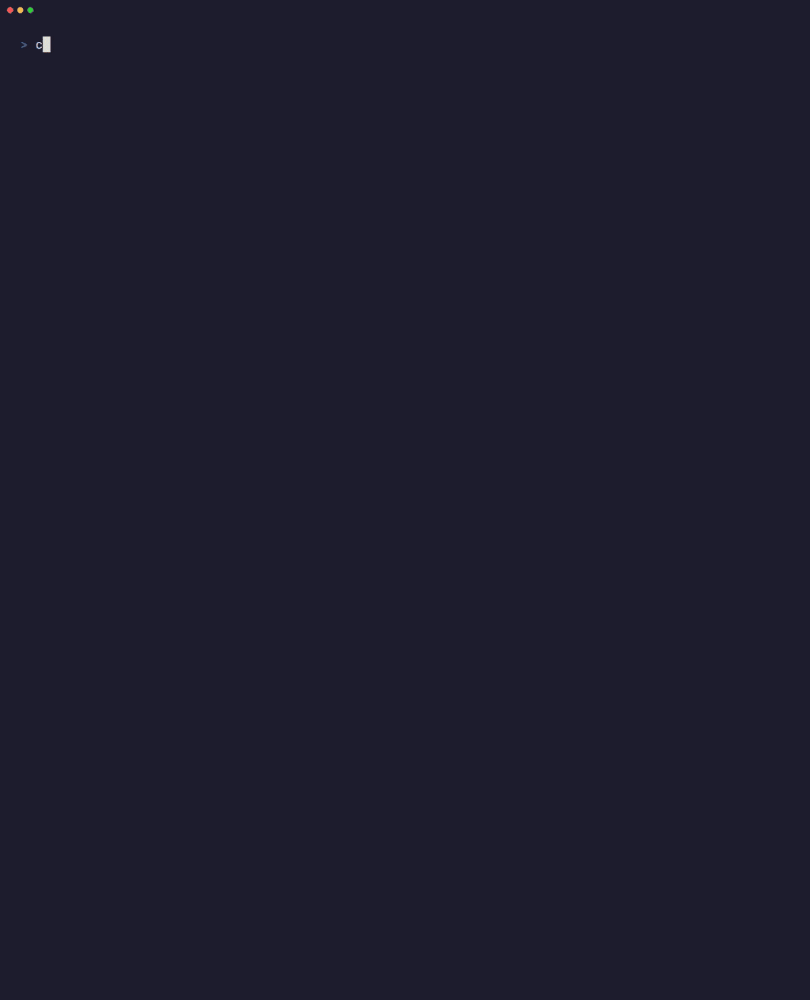

# CCL CAUT

**One command to check and update every AI coding CLI on your machine.**

<!-- WHY: one line on the problem (many agents, many update commands, many install methods). The user will write this copy. -->

[](https://github.com/CreativeCodeLogic/ccl-cli-agents-update-tool/actions/workflows/ci.yml)
[](LICENSE)
[](package.json)

CCL CAUT (**C**LI **A**gents **U**pdate **T**ool) finds the AI and developer CLIs you have installed, compares what you run with what's released, and lets you pick what to update from a single checklist. It supports 12 tools: Claude Code, Codex, GitHub Copilot, Cursor, OpenCode, Gemini, Antigravity, Qwen Code, Kimi Code, Firebase, the Google Cloud CLI and npm.



<sub>Recorded with `ccl-caut --demo` (fixture data, nothing real is updated) using [VHS](https://github.com/charmbracelet/vhs); see [`docs/demo.tape`](docs/demo.tape).</sub>

## Quick start

> **Coming to npm soon.** Until then, run it from source (below).

```bash
npx ccl-caut            # run once, no install
npm install -g ccl-caut  # or keep it around
ccl-caut
```

From source:

```bash
git clone https://github.com/CreativeCodeLogic/ccl-cli-agents-update-tool.git
cd ccl-cli-agents-update-tool
npm ci && npm run build
node dist/index.js
```

Requires Node.js 20 or newer.

## What it looks like

```text
     Tool              Installed           Latest   State             Via
  ────────────────────────────────────────────────────────────────────────────────────
  ✔  Claude Code       2.1.296             2.1.296  up-to-date        native
  ↑  Codex CLI         0.161.0             0.162.1  update available  npm
  ↻  Cursor CLI        2026.10.01-e373342  —        updates itself    native
  ⊘  Gemini CLI        0.62.1              0.63.0   retired           npm
  ↑  Antigravity CLI   1.3.1               1.3.3    update available  native
  ↑  Kimi Code         2.0.4               2.1.1    update available  native +1 hidden
  ↑  Google Cloud CLI  587.0.0             588.0.0  update available  apt
  ✔  npm               12.2.0              12.2.0   up-to-date        node
│  4 not installed: Copilot, OpenCode, Qwen, Firebase · --show-all to list
▲  gemini: retired for consumer accounts since Jun 2026 -> use Antigravity CLI (agy).
   Still works with enterprise licenses / paid API keys.
▲  kimi: native 2.0.4 runs; npm 2.1.1 is installed but shadowed on PATH
```

Then pick what to update (space toggles, enter confirms). Updates CCL CAUT can run safely run with live output; everything else is shown as a ready-to-copy command with the reason.

## Supported tools

| Tool | Install methods detected | How it is updated |
| --- | --- | --- |
| Claude Code | npm, native installer, Homebrew | npm: **auto** · native: **auto** (`claude update`) · Homebrew: command |
| Codex CLI | npm, Homebrew, standalone binary | npm: **auto** · others: command |
| GitHub Copilot CLI | npm, install script, Homebrew, winget | npm: **auto** · script: **auto** (`copilot update`) · Homebrew, winget: command |
| Cursor CLI (`agent`) | installer, Homebrew | installer: **updates itself** (`agent update` offered) · Homebrew: command |
| OpenCode | npm (v1 and v2), install script, Homebrew, Chocolatey, Scoop, winget | npm: **auto** · script: **auto** (`opencode upgrade`) · others: command |
| Gemini CLI | npm, Homebrew | **retired** for consumer accounts (see below) · npm: **auto** if you tick it · Homebrew: command |
| Antigravity CLI (`agy`) | install script, Homebrew, winget | script: **auto** (`agy update`) · Homebrew, winget: command |
| Qwen Code | npm, standalone installer, Homebrew | npm: **auto** · standalone: **auto** (`qwen update`) · Homebrew: command |
| Kimi Code | npm, native installer, legacy `kimi-cli` (uv, pipx, pip) | npm: **auto** · native: **auto** on macOS/Linux (`kimi upgrade`), installer command on Windows · legacy: command |
| Firebase CLI | npm, standalone binary | npm: **auto** · standalone: command |
| Google Cloud CLI | official installer, apt, snap, Homebrew | installer in a folder you can write to: **auto** (`gcloud components update`) · Program Files, read-only folders, apt, snap, Homebrew: command |
| npm | bundled with Node.js, global npm, Homebrew's Node | always a command |

"npm" means the global prefix of the npm on your `PATH`. Copies installed under another Node version (nvm, fnm, Volta) are detected too, and you get the right command to run with that version active.

### Gemini CLI retirement

Google retired Gemini CLI for consumer accounts (Google AI Pro and Ultra, and free use through Gemini Code Assist for individuals) on June 18, 2026; Antigravity CLI (`agy`) is the successor. Gemini CLI keeps working with Gemini Code Assist Standard/Enterprise licenses and paid API keys, so CCL CAUT still detects and can update it, but marks it **retired** and never preselects it. See [Google's announcement](https://developers.googleblog.com/an-important-update-transitioning-gemini-cli-to-antigravity-cli/).

## Safe by design

- **We only run what we can run safely.** Automatic updates are limited to `npm install -g` into your active npm prefix and the tools' own documented self-updaters, run against the exact binary on your `PATH`. Everything else (apt, snap, Homebrew, winget, Chocolatey, Scoop, admin-only folders, npm itself) gets the exact command and a one-line reason instead. Package-manager installs of the Google Cloud CLI never get `gcloud components update`.
- **Shadowed installs are called out.** CCL CAUT finds every copy of a tool on your `PATH`, updates the one that actually runs, and warns about copies that are installed but never run.
- **No false positives.** A generic binary name like Cursor's `agent` is only claimed inside Cursor's own install layout, and editor launcher shims (such as VS Code's Copilot Chat launcher) are ignored.
- **Every update is verified.** After an update, CCL CAUT asks the running binary for its version again. If it didn't change, you get a warning instead of a false success. Kimi Code's staged rollouts are reported as "held".
- **Friendly failure hints.** Locked files ("Claude Code appears to be running…") and permission problems ("run from an elevated terminal") are explained, not just dumped.
- **Careful inside agents.** Updating Claude Code from inside a Claude Code session asks for confirmation first. Under `--yes`, Claude Code is skipped: it is never updated without an explicit yes.

Platform support: developed and used daily on Windows. Detection rules for macOS and Linux (Homebrew, apt, snap, `~/.local/bin`, uv, pipx, nvm, fnm, Volta) are covered by fixture-based unit tests, every push runs the test suite plus a real scan on Ubuntu, macOS and Windows runners, and a weekly canary installs the npm-distributed CLIs for real to catch upstream changes.

## Usage

```text
ccl-caut [options]

  --check        Scan and print the table only. Exit code 1 if updates exist, else 0.
  --json         Print the scan result as JSON (no banner, no colors).
                 Combined with --check, the exit code follows --check.
  --refresh      Ignore cached latest versions (cached for 1 hour) and look them up again.
  --show-all     Also list tools that are not installed.
  -y, --yes      Don't ask: update the tools that would be preselected (your remembered
                 choices, else every outdated tool that isn't retired or self-updating).
  --reset-selection
                 Forget the selection remembered from previous runs, then run normally.
  --no-clear     Don't clear the screen when starting the interactive checklist.
  --no-color     Disable colors.
  -v, --version  Print the version.
  -h, --help     Show this help.
```

The interactive checklist starts on a clean screen: earlier output is pushed up into your scrollback, never erased. Use `--no-clear` to keep it in view; `--check`, `--json`, `--yes` and CI runs never clear.

When a newer ccl-caut is published, a one-line notice under the banner tells you how to upgrade for the way you run it (`npx ccl-caut@latest` or `npm i -g ccl-caut`). The check runs in the background, never slows a run down, stays silent when offline, and is off in CI or with `CCL_CAUT_NO_UPDATE_CHECK=1`. `--json` reports it as `"self": { "version", "latest" }`.

### Remembered selections

When you confirm the checklist, CCL CAUT remembers your choice per tool: ticked tools are preselected next time, unticked ones start unticked ("Selection remembered from your last run" appears under the prompt). Tools you've never decided on follow the defaults: preselected if outdated, unticked if retired or self-updating. `--yes` applies the same selection without asking, which makes it handy for a scheduled task. `--reset-selection` forgets everything.

Choices are stored in your OS config folder: `%APPDATA%\ccl-caut\config.json` on Windows, and `$XDG_CONFIG_HOME/ccl-caut/config.json` or `~/.config/ccl-caut/config.json` on macOS and Linux (like other developer CLIs). Latest versions are cached for an hour in your OS cache folder (`%LOCALAPPDATA%\ccl-caut`, `~/Library/Caches/ccl-caut` or `$XDG_CACHE_HOME/ccl-caut`). Set `CCL_CAUT_DEBUG=1` to see failed lookups and config or cache problems on stderr.

### Privacy & network

CCL CAUT only reads public version information. It contacts exactly these hosts, and only to fetch latest-version metadata:

| Host | What for |
| --- | --- |
| `registry.npmjs.org` | Latest versions of npm-distributed tools, and of ccl-caut itself |
| `api.github.com` | Antigravity CLI's latest release |
| `dl.google.com` | The Google Cloud SDK release feed |
| `pypi.org` | Legacy `kimi-cli` installs only |

Nothing about you or your machine is sent: no identifiers, no list of installed tools, no telemetry or analytics of any kind. Requests are plain GETs (with a `ccl-caut` user agent). Results are cached for an hour in your OS cache folder, and your remembered selections stay in your OS config folder (see above). Update commands you choose to run (for example `claude update` or `npm install -g …`) contact their own vendors, exactly as if you ran them yourself.

### Exit codes

| Code | Meaning |
| --- | --- |
| 0 | Success, or everything is up-to-date |
| 1 | Updates available (`--check`), or an update failed or did not apply |
| 2 | Invalid arguments |
| 130 | Cancelled (Ctrl+C) |

`--check` is made for CI and scripts: `ccl-caut --check || echo "updates available"`.

### JSON output

```bash
ccl-caut --json
```

```json
{
  "tool": "ccl-caut",
  "version": "1.0.0",
  "platform": "win32",
  "latestCachedAt": null,
  "summary": { "total": 12, "upToDate": 2, "outdated": 4, "notInstalled": 5, "unknown": 0, "retired": 1, "selfUpdating": 0, "shadowed": 1 },
  "tools": [
    {
      "id": "gemini",
      "name": "Gemini CLI",
      "shortName": "Gemini",
      "installed": true,
      "installMethod": "npm",
      "binaryPath": "C:\\Users\\you\\AppData\\Roaming\\npm\\gemini.cmd",
      "installedVersion": "0.63.0",
      "latestVersion": "0.63.0",
      "state": "retired",
      "updateAvailable": false,
      "plan": { "kind": "auto", "command": ["npm", "install", "-g", "@google/gemini-cli@latest"] },
      "shadowed": [],
      "deprecation": {
        "message": "retired for consumer accounts since Jun 2026 -> use Antigravity CLI (agy). Still works with enterprise licenses / paid API keys.",
        "successorId": "antigravity",
        "since": "2026-06-18",
        "url": "https://developers.googleblog.com/an-important-update-transitioning-gemini-cli-to-antigravity-cli/"
      }
    }
  ]
}
```

`state` is one of `up-to-date`, `outdated`, `not-installed`, `unknown` (a version could not be determined; never reported as outdated), `retired` or `self-updating`. `updateAvailable` tells you whether a newer version exists, even for retired tools. `plan.kind` is `auto` (CCL CAUT would run `command`) or `manual` (`command` is shown with a `reason`).

## Adding a new tool

Each CLI is one descriptor in [`src/registry/`](src/registry). For a CLI that ships on npm, the factory does most of the work:

```ts
// src/registry/mytool.ts
import { createNpmPackageTool } from "./npm-package-tool";
import { brewPlan } from "./shared";

export const mytool = createNpmPackageTool({
  id: "mytool",
  name: "My Tool",
  shortName: "MyTool",
  binNames: ["mytool"],
  pkg: "@acme/mytool",
  // Optional: plans for installs npm doesn't manage.
  otherPlan: (instance) => (instance.installMethod === "brew" ? brewPlan("mytool") : null),
});
```

Then add it to the list in [`src/registry/index.ts`](src/registry/index.ts). Tools with their own installer implement the `ToolDescriptor` interface directly (see `antigravity.ts`, `cursor.ts` and `gcloud.ts`): read the installed version, look up the latest one, and return an `auto` or `manual` update plan per install method. Optional fields cover `deprecation`, `selfUpdating` and `identify` (for generic binary names). See [CONTRIBUTING.md](CONTRIBUTING.md) for tests.

## License

MIT © Creative Code Logic. See [LICENSE](LICENSE).

---

Built by [Creative Code Logic](https://creativecodelogic.com).